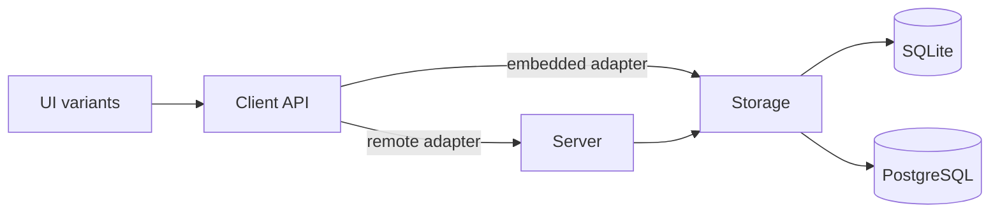

# Forge architecture — draft

Status: proposed. This document records the agreed structural direction, not a finalized product design.

## Layers

### Storage: `forge-storage`

A Rust crate owns persistence and exposes contents scoped to a user. A deployment selects SQLite or PostgreSQL. Backend selection must not change the meaning of storage operations.

The public API should require an authenticated user identity or a user-scoped handle for every read and write. The storage implementation must enforce ownership in its queries and transactions. No caller should need to write SQL or know which database is active.

The initial implementation uses SeaORM to store calendars, event definitions, recurrence rules, and per-instance exceptions. Events belong to a calendar, and calendar ownership supplies the user boundary. Each event has a separate one-to-one time row. Timed events use UTC instants plus an IANA time zone; all-day events use dates with an exclusive end. A recurring series stores its typed original local start, while an exception is keyed by its original occurrence start even when that instance is moved. Replacement exceptions have their own time row. The database has no `CHECK` constraints; the storage crate validates writes and decodes rows into typed Rust values. Recurrence expansion and ICS import remain future work.

### Server: `forge-server`

The server exposes storage operations over a versioned network protocol. It authenticates remote callers, associates each request with a user, validates input, calls the storage layer, and maps failures to stable protocol errors. Its HTTP handlers should contain no product-specific persistence logic.

### Client API: `forge-client`

This is the working name for the proposed “UI-Interface” layer. It presents one typed, asynchronous Rust interface to UI code. It has two implementations:

- **Embedded:** calls `forge-storage` in the same process.
- **Remote:** calls `forge-server` over the network.

The same operation must have the same input, output, and error meaning through either implementation. Connection details, authentication transport, serialization, and database choice stay behind this interface. UI code selects an implementation at startup, then uses the shared API.

Shared operation types may live in a small `forge-contract` crate so the server and client can use the same definitions without reversing the dependency direction. This crate is common vocabulary, not a runtime layer.

### UI variants

Each UI depends on `forge-client`, not directly on storage or server internals.

| Variant | Likely client mode | Boundary |
| --- | --- | --- |
| CLI | Embedded or remote | Commands render typed results. |
| MCP server | Embedded or remote | MCP tools map to client operations. |
| Web page | Remote | Browser code cannot open the server's database directly. |
| Native app | Embedded or remote | Desktop or mobile shell uses the same client contract. |

The table describes deployment options, not a decision about UI frameworks.

## Dependency rules

- `forge-storage` has no dependency on network or UI crates.
- `forge-server` depends on storage and shared contract types.
- `forge-client` depends on shared contract types and, for embedded builds, storage. Its remote adapter depends on the network protocol.
- UI variants depend on the client API. They must not duplicate business operations in transport-specific code.
- No backend or adapter may bypass per-user isolation.

## Contract and parity

The client contract should describe operations in product terms, once those terms are defined. Each operation needs explicit rules for identity, validation, pagination, timestamps, and failures. A common contract test suite should exercise the embedded client and the remote client against both supported database engines where practical. This keeps behavior consistent across deployment paths.

## Decisions still needed

- Which additional product entities and operations belong beside the initial calendar model.
- Whether a local embedded deployment has one user or multiple users, and how local identity is selected.
- Authentication and session behavior for remote deployments.
- Whether offline work must later synchronize with a server. Embedded and remote parity alone does not provide synchronization.
- The network protocol, UI frameworks, and deployment packaging.
